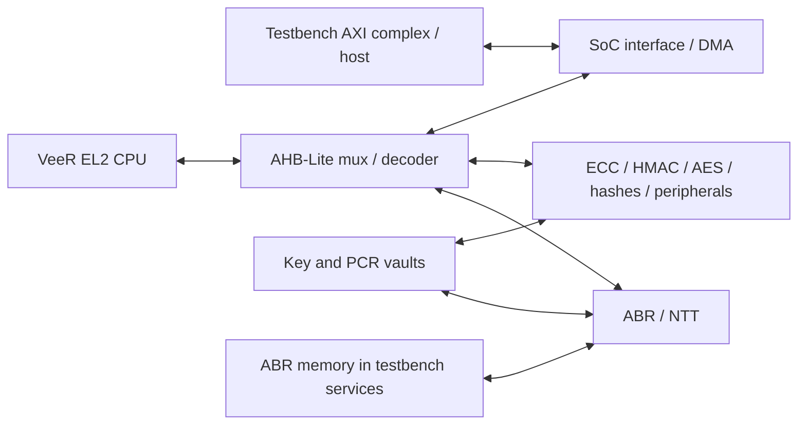

# Caliptra default: thread-unit preparation

The hierarchy inventory is complete at the requested **0.25% threshold**:
174 qualifying instances out of 15,866
elaborated scopes. CPU assignment and placement benchmarking remain pending.

Open [the interactive hierarchy](hierarchy.html) locally after downloading, or
read [every qualifying instance](instances-ge-0.25pct.csv). The [complete inventory](instances-all.csv.gz)
includes smaller instances and their own-work values. Percentages are static
compiler instruction estimates, **not runtime percentages**.

## Disjoint breakdown

These direct device-child groups, device-own work, and outside-device work sum
to 100%. The detailed hierarchy also contains inclusive parents: do not add a
parent to its children.

| Instance / group | Work, % |
|---|---:|
| `abr_inst` | 35.248 |
| `rvtop` | 10.602 |
| `Outside device` | 10.384 |
| `ecc_top1` | 9.279 |
| `hmac` | 8.476 |
| `aes_inst` | 7.319 |
| `key_vault1` | 5.243 |
| `csrng` | 2.605 |
| `soc_ifc_top1` | 2.342 |
| `pcr_vault1` | 2.318 |
| `doe` | 1.412 |
| `entropy_src` | 1.019 |
| `sha3` | 0.979 |
| `data_vault1` | 0.824 |
| `sha512` | 0.745 |
| `Device wiring / own logic` | 0.694 |
| `sha256` | 0.329 |
| All smaller groups combined | 0.184 |

## Connections and candidate boundaries

The device uses a shared AHB-Lite interconnect between the VeeR EL2 CPU and
the peripherals. The SoC interface provides external AXI access and DMA. Crypto
blocks also have direct key-vault, PCR, and memory connections; the bus diagram
alone does not describe every dependency. See the [top-level wiring](../../src/caliptra-rtl/caliptra_top.sv).

The 10.384% outside the device is accounted for: the AXI testbench complex is
5.508%, testbench services are 4.580%, and the remaining wrappers, interfaces,
assertion module, and top-level own work are 0.296%. The largest parts are the
AXI FIFO (5.422%) and ABR memory model (4.406%). These are generated simulation
work and must remain in the placement accounting.

ABR is too large to use as one unit for an eight-way static balance: 35.248%,
mostly its NTT block at 31.752%. Within the NTT hybrid butterfly, promising
child boundaries are:

| Local instance | Module type | Work, % of total |
|---|---|---:|
| `masked_bf_1x2_inst0.masked_bf_inst00` | `ntt_masked_gs_butterfly` | 7.714 |
| `masked_bf_1x2_inst0.masked_bf_inst01` | `ntt_masked_gs_butterfly` | 7.714 |
| `pwm_inst00` | `ntt_masked_pwm` | 6.790 |
| `pwm_inst01` | `ntt_masked_pwm` | 6.790 |

These are four disjoint children, not additions to the ABR percentage. Selecting
them explicitly would leave approximately 6.24% in the enclosing ABR unit.
The CPU wrapper, ECC, HMAC, AES, key vault, AXI testbench complex, and ABR memory
are other useful initial boundaries. Runtime measurements on HMAC, MLKEM, SHA3,
and TRNG are needed before assigning workers: the static inventory does not
tell us how often the arithmetic blocks execute in each workload.

Caliptra also has a substantial serial ACT region: its static cost is 2,728,914,
versus 1,222,067 for parallel NBA input logic. This ratio is not a runtime ratio;
the regions have different activation frequencies. CPU placement cannot move
that serial-region execution off the caller.

## Method and validation

RTLMeter input revision: `39a9a85c5b32da0ec8b0184fd57c9a9fb2b919ee`.
Compiler: [integration branch](https://github.com/taylor-bsg/verilator/tree/2487df5b4b8665f0caf8aed7ea174d13c037bf19),
built with Clang 21.1.8. The analysis uses eight workers, default configuration,
and no `threads_unit` directives. It includes the final wide-reset and bit-copy
changes and preserves the original scheduler and merging heuristics.

Read-only diagnostics record the hierarchy before inlining and the scheduler's
logic vertices with `V3InstrCount` costs. A separate `-fno-inline` generation
retains instance attribution. It has an NBA total of 1,222,067,
versus 1,221,405 with normal inlining
(+0.054%). These are operation-cost totals, not instruction-retirement counters.

The instrumented normal generation produced **231 byte-identical C++/header/make files**
compared with the uninstrumented compiler. Own costs sum to the denominator,
every parent's inclusive cost equals its own cost plus its children's totals,
and the disjoint groups sum to 100%. See [validation](validation.json),
[source equivalence](source-equivalence.json), and [full source/command provenance](provenance.json).
The [diagnostic patch](diagnostic.patch) is not part of the compiler integration branch.

The denominator covers input logic to parallel NBA scheduling. Initialization,
serial regions, scheduler overhead, waits, and external DPI execution are
excluded. See [summary.json](summary.json) for the other region costs.

[connections.csv](connections.csv) counts distinct scheduler-visible variables
written by one device-child group and read by another; [connectivity.json](connectivity.json)
contains their signal names. These weights are a structural proxy, not measured
bandwidth or transferred bits. Packed buses and individual array elements can
therefore have very different meanings despite contributing one count each.

The CSV module indices enumerate the full elaborated hierarchy. Once units are
chosen, regenerate `--threads-unit-list` to obtain the indices accepted by
`-workers N->W: { ... }`; optimization and instance filters can change them.
