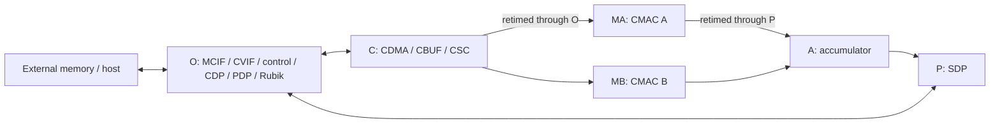

# NVDLA default: thread-unit preparation

The hierarchy inventory is complete at the requested **0.25% threshold**:
128 qualifying instances out of 130,260
elaborated scopes. CPU assignment and placement benchmarking remain pending.

Open [the interactive hierarchy](hierarchy.html) locally after downloading, or
read [every qualifying instance](instances-ge-0.25pct.csv). The [complete inventory](instances-all.csv.gz)
includes smaller instances and their own-work values. Percentages are static
compiler instruction estimates, **not runtime percentages**.

## Disjoint breakdown

These direct device-child groups, device-own work, and outside-device work sum
to 100%. The detailed hierarchy also contains inclusive parents: do not add a
parent to its children.

| Instance / group | Work, % |
|---|---:|
| `u_partition_c` | 25.878 |
| `u_partition_o` | 21.330 |
| `u_partition_p` | 19.497 |
| `u_partition_ma` | 14.175 |
| `u_partition_mb` | 14.175 |
| `u_partition_a` | 4.862 |
| All smaller groups combined | 0.083 |

## Connections and candidate boundaries

The design has a convolution pipeline, post-processing engines, and shared
memory/control interfaces. The top-level partitions are physical containers,
not equally sized compute tiles. See the [top-level connections](../../src/NV_nvdla.v)
and the `NV_NVDLA_partition_*.v` files beside it.

The arrows show the main logical data connections; request/response control,
backpressure, resets, and retiming logic add dependencies. In the actual
generated graph, for example, C→O→MA and MA→P→A carry the retimed A-side
convolution data. The structural edge list retains these container crossings.

The six partition sizes are too uneven to be the final eight-worker units.
Useful finer boundaries are:

| Partition | Child block | Work, % of total |
|---|---|---:|
| C | CSC | 11.493 |
| C | CDMA | 8.812 |
| C | CBUF | 5.461 |
| O | CDP | 8.643 |
| O | PDP | 6.673 |
| O | Rubik | 2.010 |
| O | MCIF / CVIF | 1.566 / 1.564 |
| P | SDP `u_bs` / `u_bn` | 4.886 / 4.886 |
| P | SDP `u_ew` | 5.768 |
| P | SDP `u_c` | 1.887 |
| P | SDP read DMA | 1.665 |
| MA, MB | Each complete CMAC | 14.173 |
| MA, MB | Each of eight MAC lanes per CMAC | 1.406 |
| MA, MB | Each CMAC active/selection block | 2.773 |
| A | Accumulator | 4.820 |

Parent CMAC rows include their lane and active-block rows. Splitting the SDP
stages gives manageable units. A complete CMAC is slightly larger than the
12.5% average for eight workers; its sixteen total MAC lanes provide an option
for finer balance, at the cost of more crossings. Measure runtime first to
decide whether that split is worthwhile. Preserve the connection between the
convolution sequencer, MACs, accumulator, and SDP when proposing placements.

Only 0.083% of the static NBA work lies outside `nvdla_top`. Time spent inside
external DPI memory/testbench code is not represented by this static work
percentage; it requires runtime profiling. No NVDLA placement speedup has been
measured here.

## Method and validation

RTLMeter input revision: `39a9a85c5b32da0ec8b0184fd57c9a9fb2b919ee`.
Compiler: [integration branch](https://github.com/taylor-bsg/verilator/tree/2487df5b4b8665f0caf8aed7ea174d13c037bf19),
built with Clang 21.1.8. The analysis uses eight workers, default configuration,
and no `threads_unit` directives. It includes the final wide-reset and bit-copy
changes and preserves the original scheduler and merging heuristics.

Read-only diagnostics record the hierarchy before inlining and the scheduler's
logic vertices with `V3InstrCount` costs. A separate `-fno-inline` generation
retains instance attribution. It has an NBA total of 7,505,672,
versus 7,498,416 with normal inlining
(+0.097%). These are operation-cost totals, not instruction-retirement counters.

The instrumented normal generation produced **587 byte-identical C++/header/make files**
compared with the uninstrumented compiler. Own costs sum to the denominator,
every parent's inclusive cost equals its own cost plus its children's totals,
and the disjoint groups sum to 100%. See [validation](validation.json),
[source equivalence](source-equivalence.json), and [full source/command provenance](provenance.json).
The [diagnostic patch](diagnostic.patch) is not part of the compiler integration branch.

The denominator covers input logic to parallel NBA scheduling. Initialization,
serial regions, scheduler overhead, waits, and external DPI execution are
excluded. See [summary.json](summary.json) for the other region costs.

[connections.csv](connections.csv) counts distinct scheduler-visible variables
written by one device-child group and read by another; [connectivity.json](connectivity.json)
contains their signal names. These weights are a structural proxy, not measured
bandwidth or transferred bits. Packed buses and individual array elements can
therefore have very different meanings despite contributing one count each.

The CSV module indices enumerate the full elaborated hierarchy. Once units are
chosen, regenerate `--threads-unit-list` to obtain the indices accepted by
`-workers N->W: { ... }`; optimization and instance filters can change them.
